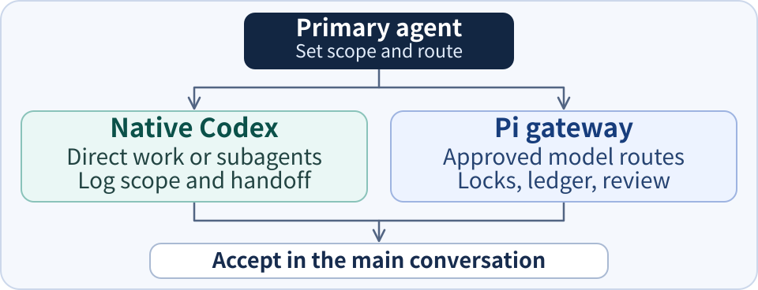

# YHWH

 

YHWH provides reusable collaboration rules for AI coding and a Pi gateway for tasks that need it. The primary agent decides how to split the work and who may write where. It owns integration and acceptance.

## Choose a route

| What you want to do | Where to start |
| --- | --- |
| Use Codex for day-to-day development and delegate to native subagents as needed | [Native Codex workflow](docs/native-codex-workflow.en.md) |
| Use governed model routing, task write locks, ledgers, or independent review | [Install and maintain Pi](docs/pi-portable-installation.en.md) |
| Connect Claude Code, OpenCode, DeepSeek Harness, or another host | [Multi-host integration](docs/host-integration.en.md) |

## Native Codex workflow

On a Codex host with native subagents enabled, review and merge the [global rules fragment](templates/codex-native/AGENTS.fragment.md). The kit has five roles for research, planning, implementation, verification, and review. Each role combines the ordered traits from `templates.toml`.

1. **Assign**. Delegate independent work early when it can shorten delivery. Record the role, permitted tools and scope, and each writer's directories and shared outputs in the main conversation.
2. **Execute**. Assign one writer to each writable scope at a time. The primary continues its own work and uses a bounded event wait when it needs a subagent's result.
3. **Hand off**. Confirm that the previous owner and related background processes have stopped writing. Record the check in the main conversation before transferring the scope. The primary owns final acceptance.

The current user and host govern authorization, tool access, and sandboxing. See [setup and an assignment example](docs/native-codex-workflow.en.md).

## Install the Pi gateway

1. On Windows 11 x64 with hardware virtualization, prepare Git, WSL2, and network access.
2. Download `YHWH-OneClick-*.zip` from the [release page](https://github.com/Yuzu482/YHWH/releases/latest) and verify its published checksum. Extract it, run `Install-YHWH.cmd`, and choose the workspace directories the gateway may access. The standalone installer supports `-PlanOnly` for a preview.
3. Import the generated MCP configuration into your host, set up the model route you plan to use, and verify connectivity and authorization on that host.

[Installation flags, existing installs, Tunnel, verification, and removal](docs/pi-portable-installation.en.md) · [Pi roles](docs/pi-role-presets.en.md) · [Worker enforcement](docs/worker-enforcement.en.md)

## Learn more

- [Operations and acceptance](docs/workflow-operations.md#english) · [Security boundaries](SECURITY-HARDENING.md) · [Verification](VERIFICATION.md)
- [Architecture history](docs/architecture-history.md) · [Release history](https://github.com/Yuzu482/YHWH/releases) · [Third-party notices](THIRD_PARTY.en.md)

YHWH's own code, documentation, and configuration are licensed under [Apache-2.0](LICENSE). [Copyright notice](NOTICE)
