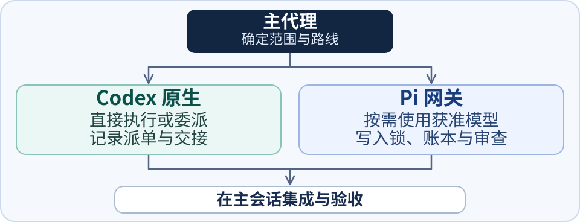

# YHWH

 

YHWH 为 AI 编码提供可复用的协作规则和按需使用的 Pi 网关。主代理决定任务怎么拆、谁可以写哪里，并负责集成和验收。

## 选择路线

| 你要做的事 | 从哪里开始 |
| --- | --- |
| 用 Codex 做日常开发，并按需分配原生子代理 | [Codex 原生工作流](docs/native-codex-workflow.md) |
| 使用受控模型路由、任务写入锁、账本或独立审查 | [Pi 安装与维护](docs/pi-portable-installation.md) |
| 把网关接入 Claude Code、OpenCode、DeepSeek Harness 等宿主 | [多宿主接入](docs/host-integration.md) |

## Codex 原生工作流

在已启用原生子代理的 Codex 宿主上，查看并合并[全局规则片段](templates/codex-native/AGENTS.fragment.md)。套件提供调研、规划、实施、验证和审查五个角色，每个角色由 `templates.toml` 选用的特质按顺序组成。

1. **派单**。独立工作能缩短交付时及早分配。在主会话记录角色、允许的工具及其范围，以及每位写入者负责的目录和共享输出。
2. **执行**。同一写入范围一次只有一个写入者。主代理推进自己负责的工作，依赖子代理结果时用有界事件等待。
3. **交接**。确认原负责人和相关后台进程已经停写，在主会话记录检查结果，再移交范围。主代理负责最终验收。

授权、工具权限和沙箱由当前用户及宿主管理。套件的启用方法及派单示例见[原生工作流指南](docs/native-codex-workflow.md)。

## 安装 Pi 网关

1. 在支持硬件虚拟化的 Windows 11 x64 上准备 Git、WSL2 和网络访问。
2. 从[发布页](https://github.com/Yuzu482/YHWH/releases/latest)下载 `YHWH-OneClick-*.zip`，核对同页提供的校验值。解压后运行 `Install-YHWH.cmd`，选择允许网关访问的工作目录。单文件安装脚本可用 `-PlanOnly` 预览。
3. 在目标宿主导入生成的 MCP 配置，按使用的模型路线登录或配置服务，并在宿主核对连通与授权。

[安装参数、已有安装、Tunnel、核验与卸载](docs/pi-portable-installation.md) · [Pi 角色](docs/pi-role-presets.md) · [执行约束](docs/worker-enforcement.md)

## 进一步了解

- [运行与验收](docs/workflow-operations.md#简体中文) · [安全边界](SECURITY-HARDENING.md) · [验证记录](VERIFICATION.md)
- [架构历史](docs/architecture-history.md) · [发布记录](https://github.com/Yuzu482/YHWH/releases) · [第三方清单](THIRD_PARTY.md)

YHWH 自有代码、文档和配置采用 [Apache-2.0](LICENSE)。[版权说明](NOTICE)
